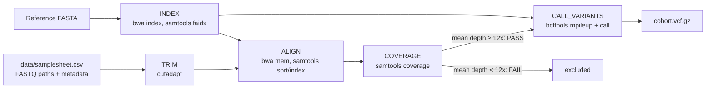

# nextflow_wgs_variant_calling

A reproducible Nextflow (DSL2) pipeline that takes paired-end whole-genome sequencing (WGS) reads from multiple individuals to a multi-sample VCF of SNPs. It trims reads, aligns them to a reference genome, checks each individual against a minimum sequencing depth, and jointly calls variants on the individuals that pass.

The pipeline runs end to end on a laptop or on an HPC cluster (tested on Northeastern University's **Explorer** cluster with SLURM), using a small simulated dataset included in this repository.

---

## Table of contents

1. [Overview](#overview)
2. [Pipeline at a glance](#pipeline-at-a-glance)
3. [Pipeline steps](#pipeline-steps)
4. [Test dataset](#test-dataset)
5. [Repository structure](#repository-structure)
6. [Requirements](#requirements)
7. [How to run](#how-to-run)
8. [Parameters](#parameters)
9. [Outputs](#outputs)
10. [Results](#results)
11. [Inspecting the results](#inspecting-the-results)
12. [Design decisions](#design-decisions)
13. [Limitations and next steps](#limitations-and-next-steps)
14. [Background](#background)

---

## Overview

Population-genomics projects often sequence many individuals per species and need every sample processed the same way, so that the results can be compared and combined. This pipeline implements the core of that process:

- **A sample sheet as input.** Each individual is one row, with its FASTQ files and sampling metadata (site, latitude, longitude, depth, date). Adding samples means adding rows, not changing code.
- **Identical processing for every sample.** Every individual goes through the same trimming, alignment and quality checks.
- **A coverage threshold before genotyping.** Individuals below a minimum mean depth (12x by default) are excluded, because low depth makes it likely that one of the two chromosome copies is missed at heterozygous sites (*heterozygote dropout*).
- **Joint variant calling.** SNPs are called across all passing individuals together, producing one cohort VCF with every individual's genotype.
- **Portable execution.** The same code runs locally or on a SLURM cluster, with software installed automatically by conda.

---

## Pipeline at a glance



**Raw reads → trimmed reads → sorted BAM → coverage check → multi-sample VCF**

---

## Pipeline steps

Example file names are for individual `S1_ind1`; every individual follows the same path.

### 1. TRIM: read quality trimming (cutadapt)

Removes low-quality bases from the 3′ end of each read and discards reads that become too short. R1 and R2 are trimmed together so read pairs stay matched.

```bash
cutadapt -q 20 -m 50 -o S1_ind1_R1.trimmed.fastq.gz -p S1_ind1_R2.trimmed.fastq.gz S1_ind1_R1.fastq.gz S1_ind1_R2.fastq.gz
```

| | |
|---|---|
| **Input** | `data/reads/S1_ind1_R1.fastq.gz`, `data/reads/S1_ind1_R2.fastq.gz` |
| **Output** | `S1_ind1_R1.trimmed.fastq.gz`, `S1_ind1_R2.trimmed.fastq.gz`, `S1_ind1.cutadapt.log` (intermediate, kept in `work/`) |
| **Key settings** | `-q 20`: trim 3′ bases below Phred quality 20 (1% error rate) · `-m 50`: drop pairs where either read is shorter than 50 bp |
| **Runs** | Once per individual, in parallel |

### 2. INDEX: reference indexing (BWA, SAMtools)

Builds the search index BWA needs for alignment and the position index (`.fai`) bcftools needs for variant calling.

| | |
|---|---|
| **Input** | `data/reference/SHH_locus_hg38.fa` |
| **Output** | `ref/` folder with `genome.fa`, the BWA index (`.amb`, `.ann`, `.bwt`, `.pac`, `.sa`) and `genome.fa.fai` (intermediate, kept in `work/`) |
| **Runs** | Once, shared by all individuals |

### 3. ALIGN: read alignment (BWA-MEM, SAMtools)

Aligns each read pair to the reference, tags reads with a read group (`ID` and `SM` = sample name), sorts by genomic position and indexes the BAM.

```bash
bwa mem -R "@RG\tID:S1_ind1\tSM:S1_ind1" ref/genome.fa R1.trimmed.fastq.gz R2.trimmed.fastq.gz | samtools sort -o S1_ind1.bam -
samtools index S1_ind1.bam
```

| | |
|---|---|
| **Input** | Trimmed R1/R2 from step 1 + `ref/` from step 2 |
| **Output** | `results/bam/S1_ind1.bam`, `results/bam/S1_ind1.bam.bai` |
| **Why the read group matters** | bcftools uses the `SM` tag to assign reads to individuals during joint calling |
| **Runs** | Once per individual |

### 4. COVERAGE: depth check (samtools coverage)

Calculates the mean depth (average number of reads covering each reference base) and marks each individual **PASS** or **FAIL** against `--min_depth`.

```bash
samtools coverage S1_ind1.bam     # column 7 = meandepth
```

| | |
|---|---|
| **Input** | `results/bam/S1_ind1.bam` + `.bai` |
| **Output** | `results/coverage/S1_ind1.coverage.txt`, e.g. `S1_ind1 mean_depth=14.4544 PASS` |
| **Rule** | PASS if mean depth ≥ 12x; only PASS individuals continue |
| **Runs** | Once per individual |

### 5. CALL_VARIANTS: joint SNP calling (bcftools)

Computes genotype likelihoods at every position across all passing individuals and calls variant sites.

```bash
bcftools mpileup -f ref/genome.fa S1_ind1.bam S1_ind2.bam ... | bcftools call -mv -Oz -o cohort.vcf.gz
```

| | |
|---|---|
| **Input** | BAM + BAI files of all PASS individuals, `ref/genome.fa` + `.fai` |
| **Output** | `results/variants/cohort.vcf.gz` |
| **Key settings** | `-m`: multiallelic caller · `-v`: output variant sites only · `-Oz`: compressed VCF |
| **Runs** | Once, for all passing individuals together |

### How the steps are connected

The `workflow` block in `main.nf` reads the sample sheet into a channel, passes each individual through TRIM → ALIGN → COVERAGE, filters out individuals that FAIL, and collects the remaining BAMs into a single CALL_VARIANTS run:

```groovy
passed = COVERAGE.out.result.filter { id, bam, bai, status -> status == 'PASS' }
CALL_VARIANTS(passed.map { it[1] }.collect(), passed.map { it[2] }.collect(), ref)
```

Nextflow runs each step as soon as its inputs are ready, so different individuals are processed in parallel.

---

## Test dataset

All sequencing data are **simulated** with `scripts/simulate_data.py` (fixed random seed; running `python3 scripts/simulate_data.py` from the project folder reproduces the same reads, sample sheet and truth VCF).

| Component | Description |
|---|---|
| **Reference** | Human *SHH* locus from hg38, chr7:155,799,980–155,812,463 (12,484 bp; RefSeq NM_000193 genomic region). A real sequence used as a compact test reference |
| **Individuals** | 8 diploid individuals, 2 from each of 4 sampling sites (S1–S4) along a south-to-north gradient; coordinates are made up |
| **Variants** | 40 SNPs simulated, 39 carried by at least one individual; 10 have allele frequencies that increase from S1 to S4 |
| **Reads** | Paired-end, 2 × 100 bp, ~300 bp fragments, 0.2% substitution errors, 20% of reads with a low-quality 3′ tail |
| **Depth** | 15x for 7 individuals; **6x for `S4_ind2`**, deliberately below the 12x threshold to test the coverage check |
| **Truth set** | `data/truth/truth_variants.vcf`: every individual's true genotype at every SNP |

**Sample sheet** (`data/samplesheet.csv`):

```
sample_id,site,latitude,longitude,depth_m,collection_date,fastq_1,fastq_2
S1_ind1,S1,41.3,-70.6,12,2025-06-10,data/reads/S1_ind1_R1.fastq.gz,data/reads/S1_ind1_R2.fastq.gz
...
```

---

## Repository structure

```
nextflow_wgs_variant_calling/
├── main.nf                    # pipeline: processes + workflow
├── nextflow.config            # profiles: standard (local tools) and conda
├── README.md
├── data/                      # all inputs
│   ├── samplesheet.csv        # one row per individual: FASTQ paths + metadata
│   ├── reference/
│   │   └── SHH_locus_hg38.fa  # reference genome
│   ├── reads/                 # 16 FASTQ files (8 individuals × R1/R2)
│   └── truth/
│       └── truth_variants.vcf # true genotypes of the simulated individuals
├── scripts/                   # helper scripts
│   ├── run_pipeline.sbatch    # SLURM batch script for HPC clusters
│   └── simulate_data.py       # regenerates the simulated test data
├── envs/
│   └── environment.yml        # software: cutadapt, bwa, samtools, bcftools
├── results/                   # pipeline outputs (created by the run)
│   ├── bam/                   # alignments (not tracked in Git: large)
│   ├── coverage/              # depth + PASS/FAIL per individual
│   └── variants/              # cohort.vcf.gz
└── logs/                      # SLURM job logs (not tracked in Git)
```

`main.nf` and `nextflow.config` stay in the top folder, where Nextflow expects them. Nextflow also creates a `work/` folder for intermediate files during a run; it is not tracked in Git.

---

## Requirements

- [Nextflow](https://www.nextflow.io/) ≥ 23.04 (tested with 24.10.3) and Java 11+
- Either the tools on your `PATH` (cutadapt, BWA, SAMtools ≥ 1.13, bcftools), **or** conda, which installs them automatically via `envs/environment.yml`

---

## How to run

### On a SLURM cluster (e.g. Northeastern Explorer)

```bash
git clone https://github.com/timondm0704/nextflow_wgs_variant_calling.git
cd nextflow_wgs_variant_calling
sbatch scripts/run_pipeline.sbatch
```

`scripts/run_pipeline.sbatch` requests one compute node (2 CPUs, 4 GB, 1 hour), loads the Nextflow and Anaconda modules, and runs:

```bash
nextflow run main.nf -profile conda -resume
```

Module names and the partition (`short`) are specific to Explorer; adjust them for other clusters. Submit it from the project folder. Monitor the job with `squeue -u $USER` and `tail logs/nextflow_wgs_<jobID>.out`. The first run takes about 10 extra minutes while conda builds the environment.

### Locally

```bash
# with conda
nextflow run main.nf -profile conda

# with tools already installed (e.g. brew install cutadapt bwa samtools bcftools)
nextflow run main.nf -profile standard
```

Add `-resume` to rerun only the steps whose inputs or code have changed.

---

## Parameters

| Parameter | Default | Description |
|---|---|---|
| `--samplesheet` | `data/samplesheet.csv` | CSV with `sample_id`, `fastq_1`, `fastq_2` (plus optional metadata columns) |
| `--reference` | `data/reference/SHH_locus_hg38.fa` | Reference genome FASTA |
| `--min_depth` | `12` | Minimum mean depth for an individual to PASS |
| `--outdir` | `results` | Output folder |

Example: `nextflow run main.nf -profile conda --min_depth 15 --outdir results_15x`

---

## Outputs

```
results/
├── bam/          S1_ind1.bam, S1_ind1.bam.bai, ...   sorted, indexed alignments (8 individuals)
├── coverage/     S1_ind1.coverage.txt, ...          mean depth + PASS/FAIL per individual
└── variants/     cohort.vcf.gz                      SNPs + genotypes for all PASS individuals
```

Intermediate files (trimmed reads, reference index, per-step logs, conda environment) stay in Nextflow's `work/` directory. The coverage reports and VCF are small and are included in this repository; BAM files are not tracked in Git because of their size.

---

## Results

Run on Explorer with Nextflow 24.10.3 (`sbatch scripts/run_pipeline.sbatch`).

### Coverage check

| Individual | Site | Mean depth | Status |
|---|---|---|---|
| S1_ind1 | S1 | 14.45x | PASS |
| S1_ind2 | S1 | 14.37x | PASS |
| S2_ind1 | S2 | 14.42x | PASS |
| S2_ind2 | S2 | 14.38x | PASS |
| S3_ind1 | S3 | 14.41x | PASS |
| S3_ind2 | S3 | 14.41x | PASS |
| S4_ind1 | S4 | 14.44x | PASS |
| S4_ind2 | S4 | 5.79x | **FAIL** (excluded from variant calling) |

The individuals were simulated at 15x; trimming removes low-quality bases, which lowers mean depth to about 14.4x. The low-depth individual was correctly flagged and excluded.

### Variant calling

- **40 SNPs** called across the 7 passing individuals, compared with **39 true SNPs** in the simulated data.
- The calls shown below have mapping quality 60 (the maximum) and QUAL values in the hundreds, and each genotype matches its read counts. Example:

```
#CHROM     POS  REF ALT QUAL     ...  S1_ind1           S1_ind2            ...  S4_ind1
SHH_locus  506  C   G   643.762  ...  0/0:0,39,255:13,0 1/1:255,45,0:0,15  ...  0/1:195,0,119:5,10
```

At position 506, `S1_ind2` is homozygous for the alternate allele (`1/1`, 15 reads with G), and `S4_ind1` is heterozygous (`0/1`, 5 reads with C and 10 with G).

The difference of one call can be checked position by position against the truth set (see [Inspecting the results](#inspecting-the-results)). Extra calls in simulated data usually come from sequencing errors, which a quality filter would remove (see [Limitations and next steps](#limitations-and-next-steps)).

---

## Inspecting the results

```bash
# coverage summary
cat results/coverage/*.txt

# number of SNPs
zcat results/variants/cohort.vcf.gz | grep -vc '^#'

# position, alleles, quality and genotypes as a table
bcftools query -H -f '%POS\t%REF\t%ALT\t%QUAL[\t%GT]\n' results/variants/cohort.vcf.gz

# compare called positions with the truth set
comm -12 <(zcat results/variants/cohort.vcf.gz | grep -v '^#' | cut -f2 | sort) \
         <(grep -v '^#' data/truth/truth_variants.vcf | cut -f2 | sort) | wc -l   # true positives
```

**Reading a genotype field** such as `0/1:195,0,119:5,10`: `GT` = `0/1` (one reference and one alternate allele) · `PL` = `195,0,119` (phred-scaled likelihoods of 0/0, 0/1, 1/1; 0 = most likely) · `AD` = `5,10` (reads supporting the reference and alternate allele).

---

## Design decisions

| Decision | Reason |
|---|---|
| **Nextflow** | Parallel execution across samples, automatic resume after failures (`-resume`), isolated work directories so samples never overwrite each other, and the same code on a laptop or a cluster |
| **Sample sheet input** | Keeps metadata attached to each sample and makes the pipeline scale by adding rows, as in nf-core pipelines |
| **Paired-end reads** | Standard for Illumina WGS; read pairs improve alignment accuracy, especially in repetitive regions |
| **cutadapt with `-q 20 -m 50`** | Removes unreliable 3′ bases while keeping pairs matched and discarding reads too short to align confidently |
| **BWA-MEM** | Widely used aligner for short-read WGS and variant calling |
| **12x depth threshold before calling** | Below ~12x, the chance of sampling only one chromosome copy at a heterozygous site rises sharply, so genotypes become unreliable |
| **Joint calling with bcftools** | Calling all individuals together uses information across the cohort and produces one VCF with consistent sites |
| **conda environment file** | Records the software needed and installs it automatically for reproducible runs |

---

## Limitations and next steps

This is a compact demonstration on a 12.5 kb reference. A production version would add:

| Addition | Purpose |
|---|---|
| Variant filtering (`bcftools view -i 'QUAL>=30'`, depth filters) | Remove low-confidence calls |
| Duplicate marking (`samtools markdup` or Picard) | Avoid PCR duplicates inflating depth and genotype confidence |
| QC reports (FastQC/fastp + MultiQC) | Per-sample read quality before and after trimming |
| Accuracy evaluation step | Automatically compare calls with a truth set (sensitivity, precision, genotype concordance) |
| A `slurm` profile | Let Nextflow submit each step as its own cluster job, scaling to hundreds of samples |
| Containers (Docker/Singularity) | Fixed software versions on any system |
| Pooled-sequencing branch | Allele-frequency estimation for pool-seq samples |
| Metadata-aware downstream analyses | Join sample metadata with genotypes for population structure and genotype–environment association analyses |
| Alternative callers (e.g. GATK HaplotypeCaller) | Compare call sets and choose the best approach per dataset |

---

## Background

This project started as an exercise in **BINF 6310 (Northeastern University)**, where I wrote single-step Nextflow scripts for read trimming with cutadapt and alignment with Bowtie2 on a few hand-written reads. Reviewing those outputs taught me several lessons that shaped this pipeline:

- A reference containing duplicated sequence gives reads low mapping quality, because they align equally well to several places.
- Test reads need to come from the reference; hand-typed sequences did not align at all.
- Quality trimming only has an effect when reads actually contain low-quality bases.
- Pipeline outputs need unique, sample-based names and a published results folder.

I rebuilt it as a multi-step WGS workflow: a metadata sample sheet as input, paired-end reads, BWA-MEM alignment, a depth threshold before genotyping, joint variant calling, and a simulated dataset with a known truth set.

**Author:** Mao Ding · [Portfolio](https://timondm0704.github.io)
