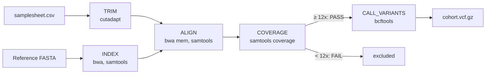

# nextflow_wgs_variant_calling

A reproducible Nextflow (DSL2) pipeline for paired-end whole-genome sequencing (WGS) data. It trims reads, aligns them to a reference genome, checks each sample's coverage, and jointly calls SNPs on the samples that pass.

The pipeline was tested on Northeastern University's **Explorer** cluster (SLURM) with a small simulated dataset.

## Overview

- **Sample sheet input:** each sample is one row with its FASTQ files and metadata (site, latitude, longitude, depth, date). Adding samples means adding rows, not changing code.
- **Same processing for every sample:** identical trimming, alignment and quality checks.
- **Coverage check before genotyping:** samples below 12x mean coverage are excluded, because low coverage can miss one of the two alleles at heterozygous sites (*heterozygote dropout*).
- **Joint variant calling:** SNPs are called across all passing samples together, producing one VCF.
- **Portable:** the same code runs on a laptop or a SLURM cluster, with tools installed automatically by conda.

## Pipeline



| Step | Tool | What it does | Input | Output |
|---|---|---|---|---|
| **TRIM** | cutadapt | Trims 3′ bases below Q20 and drops read pairs shorter than 50 bp | `data/reads/<sample>_R1/R2.fastq.gz` | Trimmed FASTQ (intermediate) |
| **INDEX** | bwa index, samtools faidx | Indexes the reference (runs once) | `data/reference/SHH_locus_hg38.fa` | Reference index (intermediate) |
| **ALIGN** | bwa mem, samtools sort/index | Aligns read pairs, adds a read group (sample name), sorts and indexes | Trimmed FASTQ + reference index | `results/bam/<sample>.bam` + `.bai` |
| **COVERAGE** | samtools coverage | Calculates mean coverage; PASS if ≥ 12x | BAM | `results/coverage/<sample>.coverage.txt` |
| **CALL_VARIANTS** | bcftools mpileup, call | Calls SNPs jointly across passing samples | BAMs of PASS samples + reference | `results/variants/cohort.vcf.gz` |

Nextflow runs each step as soon as its inputs are ready, so samples are processed in parallel.

## Test data

All sequencing data are simulated with `scripts/simulate_data.py` (fixed random seed, fully reproducible).

| Component | Description |
|---|---|
| Reference | Human *SHH* region from hg38, chr7:155,799,980–155,812,463 (12,484 bp), used as a compact test sequence |
| Samples | 8 diploid individuals, 2 from each of 4 sites (S1–S4) |
| Reads | Paired-end 2 × 100 bp, 0.2% sequencing errors, some low-quality read ends |
| Coverage | 15x for 7 samples; **6x for `S4_ind2`**, to test the coverage check |
| Truth set | `data/truth/truth_variants.vcf`: 39 true SNPs with every sample's genotype |

## Folder structure

```
nextflow_wgs_variant_calling/
├── main.nf                 # pipeline
├── nextflow.config         # settings (standard and conda profiles)
├── data/
│   ├── samplesheet.csv     # one row per sample: FASTQ paths + metadata
│   ├── reference/          # reference genome
│   ├── reads/              # 16 FASTQ files (8 samples × R1/R2)
│   └── truth/              # true genotypes
├── scripts/
│   ├── run_pipeline.sbatch # SLURM batch script
│   └── simulate_data.py    # regenerates the test data
├── envs/
│   └── environment.yml     # cutadapt, bwa, samtools, bcftools
├── results/                # pipeline outputs
└── logs/                   # SLURM logs
```

## How to run

**On a SLURM cluster (e.g. Explorer):**

```bash
git clone https://github.com/timondm0704/nextflow_wgs_variant_calling.git
cd nextflow_wgs_variant_calling
sbatch scripts/run_pipeline.sbatch
```

The batch script requests 2 CPUs, 4 GB and 1 hour, loads Nextflow and Anaconda, and runs `nextflow run main.nf -profile conda -resume`. Module names and the partition are specific to Explorer.

**Locally (requires Nextflow and conda):**

```bash
nextflow run main.nf -profile conda
```

**Options:**

| Parameter | Default | Description |
|---|---|---|
| `--samplesheet` | `data/samplesheet.csv` | Sample sheet |
| `--reference` | `data/reference/SHH_locus_hg38.fa` | Reference genome |
| `--min_coverage` | `12` | Minimum mean coverage to PASS |
| `--outdir` | `results` | Output folder |

## Results

| Sample | Mean coverage | Status |
|---|---|---|
| S1_ind1 | 14.45x | PASS |
| S1_ind2 | 14.37x | PASS |
| S2_ind1 | 14.42x | PASS |
| S2_ind2 | 14.38x | PASS |
| S3_ind1 | 14.41x | PASS |
| S3_ind2 | 14.41x | PASS |
| S4_ind1 | 14.44x | PASS |
| S4_ind2 | 5.79x | **FAIL** (excluded) |

- The low-coverage sample was correctly excluded from variant calling. (Samples were simulated at 15x; trimming lowers this to about 14.4x.)
- **40 SNPs** were called across the 7 passing samples, compared with **39 true SNPs** in the simulated data.

Example VCF record:

```
#CHROM     POS  REF  ALT  QUAL     ...  S1_ind2            S4_ind1
SHH_locus  506  C    G    643.762  ...  1/1:255,45,0:0,15  0/1:195,0,119:5,10
```

At position 506, `S1_ind2` is homozygous for G (`1/1`, 15 reads with G) and `S4_ind1` is heterozygous (`0/1`, 5 reads with C and 10 with G).

## Design choices

- **Nextflow:** parallel execution, `-resume` after failures, isolated work directories, and the same code locally or on SLURM.
- **BWA-MEM:** a standard aligner for WGS variant calling.
- **12x coverage threshold:** below this, heterozygous genotypes become unreliable.
- **Joint calling with bcftools:** one VCF with consistent sites across all samples.
- **conda environment file:** records and installs the required software for reproducible runs.

## Next steps

- Variant quality filtering (e.g. `bcftools view -i 'QUAL>=30'`)
- Duplicate marking (`samtools markdup` or Picard)
- Read QC reports (FastQC/fastp + MultiQC)
- An automatic accuracy check against the truth set
- A SLURM profile so each step runs as its own cluster job

## Background

This project started as an exercise in BINF 6310 (Northeastern University), where I wrote single-step Nextflow scripts for trimming with cutadapt and alignment with Bowtie2. I extended it into a multi-step WGS pipeline with a sample sheet, paired-end reads, BWA-MEM alignment, a coverage check, joint variant calling, and simulated data with a known truth set.

**Author:** Mao Ding · [Portfolio](https://timondm0704.github.io)
